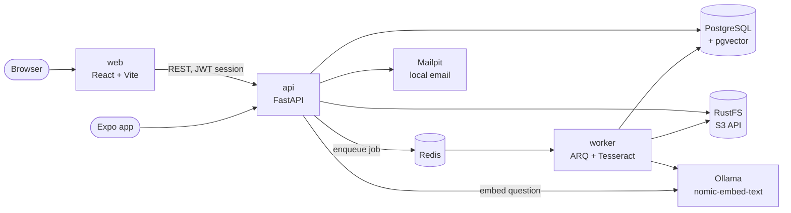

<div align="center">
  
  <h1>DocVault</h1>
  <p><strong>Personal AI Document Assistant</strong></p>
  <p>Final year project that helps users turn the documents they keep into a personal knowledge base they can talk to. DocVault is designed to use those files as its long-term memory. Users describe what they need in their own words, and the assistant draws on their records to answer with evidence, connect information across documents, and propose actions for their approval.</p>
  <a href="LICENSE"></a>
  <a href="https://github.com/haydenteh5526/DocVault/commits/main"></a>
  
</div>

---

## Key Features

- **Document capture** — Upload PDFs or photos. A background worker extracts text with Tesseract while you continue using the vault.
- **Document library** — Organise files with categories, tags and favourites. Compare the original with extracted text and restore earlier text versions.
- **Hybrid search** — Find documents by exact words or meaning using PostgreSQL full-text search and local embeddings.
- **Document Q&A** — Retrieve relevant excerpts and get answers with sources when a Q&A provider is configured. Without one, the reply lists the matching passages with their document and the OCR lines they cover. A question asked across all documents that matches nothing closely enough (similarity below 0.55, provisional) is answered "I couldn't find this in your documents." In a chat, requests about a bill (its amount and dates, an equal split, a reminder proposal, a draft question for the supplier) are answered from the bill values you confirmed (values you have not confirmed are shown labelled as unconfirmed). Nothing is approved or saved as a reminder or split from the chat: a reminder request creates a pending proposal that you approve or cancel in the bill's panel. A keyword router picks the action by default. The chat shows the result under the reply: the confirmed facts with their source lines, an unsaved split preview, a pending reminder proposal, or an editable enquiry draft that is never sent. Set `ASSISTANT_MODEL` to an Ollama tag to let a local model pick the action instead; it is empty by default because no model passed the evaluation (see Answer generation).
- **Bill review** — Compare the amount due, due date and billing period with their source lines and the original bill.
- **Bill split** — Save housemate names in your account, then split the confirmed amount equally in whole cents. Everyone pays the same, and leftover cents go one each to the first people in the order shown (€123.47 among four is €30.87, €30.87, €30.87 and €30.86). You can also enter the days each person was at home during the confirmed billing period. Each share follows that proportion, with leftover cents assigned by largest fractional remainder and ties resolved in the order shown. You review the exact shares and total before saving, and a saved split is marked out of date, not recalculated, when a newer bill revision is confirmed.
- **Bill reminder** — Choose how many days before the due date to be reminded and review the exact proposal: the bill, the amount, the reminder date and the saved split. Nothing is saved until you approve it, and approving twice saves it once. A bill or split that changes after the proposal leaves it unsaved. A saved reminder is a record in your account shown in the document's Reminder panel, with a history of what was proposed, approved and saved. Nothing is sent outside the app: no push, email, calendar file or payment.
- **Private accounts** — Sign in to your own vault and use the local inbox for account verification and password recovery.

Demo 1 covers read-only bill review. Owner-confirmed bill revisions, the equal bill split and one approved internal reminder are
implemented. Enquiry drafts are described in the [MVP design](specs/MVP_Technical_Design.md).
Forecasting is an optional experiment that depends on having enough comparable bills.

---

## Tech Stack

| Layer | Technology |
| --- | --- |
| Frontend | React, TypeScript, Vite, Tailwind CSS, TanStack Query |
| Backend | Python, FastAPI, Pydantic, SQLAlchemy, Alembic |
| Database | PostgreSQL with pgvector |
| File storage | S3 API, served locally by RustFS |
| Background jobs | Redis, ARQ |
| Document processing | Tesseract OCR, Ollama embeddings |
| Answer generation | Groq or Gemini when a key is set. Local generation with Ollama is under evaluation in [#5](https://github.com/haydenteh5526/DocVault/issues/5). On 12 November, `qwen3:8b` was measured not feasible on the project laptop (tool selection 87.5%, answers 85.7%, against a 90% threshold), so answer generation is not local and no local model is integrated. On 18 November, tool selection for chat requests was measured on 30 synthetic cases (3 runs each): the keyword router, the default, passed 80.0%; `qwen3:8b` 76.7%, `llama3.1:8b` 56.7% and `qwen3.5:4b` 83.3%, each with 3 unsafe rows and none reaching the 90% threshold. The keyword router therefore stays the default and local model selection is not feasible on the project laptop with these models. See the [12 November run](evaluation/results/2026-11-12/RUN.md) and the [18 November run](evaluation/results/2026-11-18/RUN.md). |
| Local email | Mailpit |
| Testing and CI | pytest, Ruff, Vitest, Playwright, GitHub Actions |
| Runtime | Docker Compose |
| Mobile companion | React Native, Expo |

---

## Architecture

DocVault runs as a set of Docker Compose services on one machine. The web client and the mobile companion call one FastAPI service. Slow work, such as OCR and embedding, runs in a background worker.



**How a document becomes an answer:**

1. **Capture.** `POST /api/v1/documents` stores the original file in S3-compatible storage and queues a processing job in Redis. If the queue is unavailable, the API processes the file within the request.
2. **Read.** The ARQ worker extracts the text with Tesseract OCR. It splits the text into passages of about 500 characters, with a 50-character overlap.
3. **Remember.** Each passage is stored in PostgreSQL twice over: with a full-text index for exact words, and with a `nomic-embed-text` vector in pgvector for meaning.
4. **Answer.** A question is embedded with the same model. The keyword and vector rankings are fused with reciprocal rank fusion (k = 60). Each passage in the reply names its document and the OCR lines it covers. A question asked across all documents that matches nothing above a similarity of 0.55 (provisional) gets "I couldn't find this in your documents."
5. **Act.** In a chat, a keyword router picks one action from a fixed list. Bill answers use only values the owner has confirmed, and the server works out splits in whole cents. A reminder is saved only when the owner approves the exact proposal; approving twice saves it once.

**Design decisions:**

- **Hybrid search.** Keyword search finds exact amounts and dates, and meaning-based search finds paraphrases. Reciprocal rank fusion combines the two rankings without tuning weights ([Cormack, Clarke and Buettcher, 2009](https://doi.org/10.1145/1571941.1572114)).
- **Answers from retrieved passages.** Answers come from the user's own documents and show their evidence, following retrieval-augmented generation ([Lewis et al., 2020](https://arxiv.org/abs/2005.11401)).
- **Bounded tool use.** The assistant chooses from allowlisted tools, as in reasoning-and-acting agents ([Yao et al., 2023](https://arxiv.org/abs/2210.03629)), but every value is checked and every change is approved on the server.
- **Ownership and untrusted text.** Every read and write checks that the document belongs to the signed-in user. Document text is treated as evidence, never as instructions.
- **Local, €0.** Everything runs locally with local OCR and embeddings. The `terraform/` folder holds an optional AWS setup; no cloud deployment has been tested yet.

**Known limitations:**

- OCR on a poor scan can give wrong text, so bill values are confirmed by the owner before they are used.
- Retrieval can rank the wrong document first, and the 0.55 cut-off is not yet calibrated. The retrieval benchmark is planned before Demo 2.
- No language model writes answers unless a Groq or Gemini key is set. Without one, the reply shows the matching passages.
- The stack runs on a single machine and has not been load-tested.

---

## Quick Start

### Prerequisites

- Git and Docker with Docker Compose. The local demo needs no API keys.
- Node.js 22.13 or newer and npm for host web development, Expo, or JavaScript checks.

### Start the web stack

Clone the repository in PowerShell:

```powershell
git clone https://github.com/haydenteh5526/DocVault.git
cd DocVault
```

From the repository root, start the services:

```powershell
if (-not (Test-Path .env)) { Copy-Item .env.example .env }
docker compose up -d --build
docker compose exec api alembic upgrade head
docker compose exec ollama ollama pull nomic-embed-text
```

### Verify

1. Check [API readiness](http://localhost:8000/health/ready).
2. Register in the [web app](http://localhost:3000) and verify your account in the [local inbox](http://localhost:8025).
3. Upload the [synthetic electricity bill](evaluation/demo-1/synthetic-electricity-bill.pdf). When processing finishes, open **Summary → Bill review** and compare the three fields with the original. See the [Demo 1 walkthrough](evaluation/demo-1/README.md) for the expected values.

### Web development

To run Vite on the host, use `docker compose up -d --build api worker` in place
of the full stack command above. Keep the migration and model setup steps.
If the Compose web service is already running, free port 3000 with
`docker compose stop web`.

```powershell
cd frontend
npm ci
npm run dev
```

Vite serves the web app at <http://localhost:3000> and forwards `/api` requests
to FastAPI on port 8000.

### Mobile companion

With the API running, start Expo from the repository root:

```powershell
cd mobile
npm ci
npm start
```

For a physical device, set `EXPO_PUBLIC_API_URL` to the computer's LAN address
and API port, for example `http://192.168.1.10:8000`, before starting Expo.

---

## Environment Variables

Use [`.env.example`](.env.example) for the full local configuration.

| Variable | Default or use |
| --- | --- |
| `OCR_BACKEND` | `tesseract` for local text extraction |
| `EMBEDDING_PROVIDER` | `auto`. Set `ollama` to pin local embeddings for an evaluation run. |
| `GROQ_API_KEY` or `GEMINI_API_KEY` | Optional. Enable generated Q&A. Without a key, development mode returns retrieved excerpts. |
| `FRONTEND_URL` | `http://localhost:3000`. Used in verification and recovery links. |
| `EXPO_PUBLIC_API_URL` | Optional API base URL for the mobile client. Set it in the shell that starts Expo. |

---

## Project Structure

```text
DocVault/
├── backend/
│   ├── app/              # API, document processing and background jobs
│   ├── alembic/          # Database migrations
│   └── tests/            # Python tests
├── frontend/
│   ├── src/pages/        # React web screens
│   ├── src/components/   # Shared UI
│   ├── src/lib/          # API client, sessions and query state
│   └── e2e/              # Playwright browser tests
├── mobile/               # Expo companion app
├── specs/                # Design, tickets and current state
├── evaluation/           # Demo fixture and assessment evidence
├── scripts/              # Restore pinned research references
├── terraform/            # Optional AWS infrastructure
└── docker-compose.yml    # Local development stack
```

---

## API Endpoints

| Method | Endpoint | Description |
| --- | --- | --- |
| GET | `/health/ready` | Check service dependencies |
| POST | `/api/v1/auth/register` | Create an account and send a verification link |
| POST | `/api/v1/auth/login` | Start a session |
| POST | `/api/v1/auth/forgot-password` | Request a reset link |
| GET | `/api/v1/documents` | List your documents |
| POST | `/api/v1/documents` | Upload a document for processing |
| GET | `/api/v1/documents/{document_id}` | Get document details and bill candidates when available |
| POST | `/api/v1/documents/{document_id}/bill-revisions` | Save owner-confirmed bill values as a new revision |
| GET | `/api/v1/housemates` | List your saved housemate names |
| POST | `/api/v1/housemates` | Save a housemate name (up to 12, no duplicates) |
| DELETE | `/api/v1/housemates/{housemate_id}` | Remove a housemate name |
| POST | `/api/v1/documents/{document_id}/bill-splits/preview` | Calculate an equal or days-at-home split of the confirmed amount without saving |
| POST | `/api/v1/documents/{document_id}/bill-splits` | Save the split you reviewed, bound to the confirmed revision it used |
| POST | `/api/v1/documents/{document_id}/reminder-proposals` | Propose a reminder a number of days before the confirmed due date (nothing is saved yet) |
| POST | `/api/v1/documents/{document_id}/reminder-proposals/{proposal_id}/approve` | Save the reminder you reviewed, once (201 the first time, 200 with the same outcome after that) |
| POST | `/api/v1/documents/{document_id}/reminder-proposals/{proposal_id}/cancel` | Cancel a pending proposal |
| GET | `/api/v1/search?q=...` | Search your documents |
| POST | `/api/v1/ai/ask` | Ask a question and retrieve source excerpts |

See the full [API reference](http://localhost:8000/docs) while the stack is running.

---

## Documentation

| Document | Contents |
| --- | --- |
| [MVP technical design](specs/MVP_Technical_Design.md) | Evidence flow, planned workflow and approval rules |
| [Tickets](specs/Tickets.md) | Epic and stories linked to GitHub Issues |
| [Repository current state](specs/Repo_Current_State.md) | Verified capabilities, results and limits |
| [Evaluation](evaluation/README.md) | Assessment protocols, fixtures and results |

---

## Testing

Install the component dependencies and configure disposable test services using
the [verification guide](AGENTS.md#verification). Run each command from the
directory shown.

```powershell
# backend/
python -m pytest tests/ --cov=app --cov-fail-under=65

# frontend/
npm test
npx playwright test

# mobile/
npm run typecheck
npm run doctor
```

The [CI workflow](.github/workflows/ci.yml) also checks dependencies, migrations
and the production web build.

---

## License

[MIT](LICENSE)
